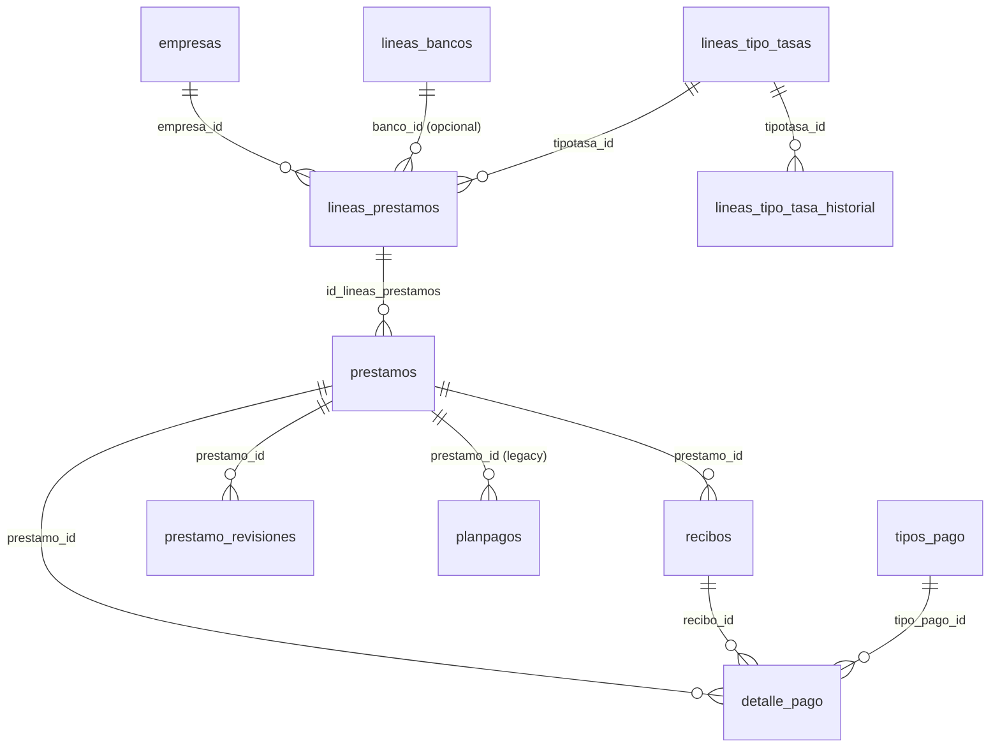

# 02 · Base de datos

Motor: **SQL Server**, base `Lineas`. Todas las tablas de negocio usan llave primaria `id bigint IDENTITY`. Las longitudes de texto se indican en **caracteres** (la herramienta de esquema de SQL Server las muestra duplicadas porque cuenta bytes de `nvarchar`).

## 1. Diagrama entidad-relación

Las tablas `users`, `sessions`, `cache`, `jobs`, etc. son las estándar de Laravel y no se relacionan con el negocio por llave foránea.

## 2. Resumen de llaves

### Llaves primarias

Todas las tablas de negocio: `id` (bigint, identity, clustered). Excepciones estándar de Laravel: `sessions.id`, `cache.key`, `cache_locks.key`, `password_reset_tokens.email`, `job_batches.id`.

### Llaves foráneas (todas `NO ACTION` al borrar/actualizar)

| Tabla hija | Columna | Tabla padre | Nombre de la restricción | Opcional |
|---|---|---|---|---|
| `lineas_prestamos` | `empresa_id` | `empresas.id` | `FK_lineas_prestamos_empresas` | No |
| `lineas_prestamos` | `tipotasa_id` | `lineas_tipo_tasas.id` | `FK_lineas_prestamos_lineas_tipo_tasas` | No |
| `lineas_prestamos` | `banco_id` | `lineas_bancos.id` | `lineas_prestamos_banco_id_foreign` | **Sí** (nulo) |
| `lineas_tipo_tasa_historial` | `tipotasa_id` | `lineas_tipo_tasas.id` | `lineas_tipo_tasa_historial_tipotasa_id_foreign` | No |
| `prestamos` | `id_lineas_prestamos` | `lineas_prestamos.id` | `FK_prestamos_lineas_prestamos` | No |
| `recibos` | `prestamo_id` | `prestamos.id` | `recibos_prestamo_id_foreign` | No |
| `detalle_pago` | `recibo_id` | `recibos.id` | `detalle_pago_recibo_id_foreign` | No |
| `detalle_pago` | `prestamo_id` | `prestamos.id` | `detalle_pago_prestamo_id_foreign` | No |
| `detalle_pago` | `tipo_pago_id` | `tipos_pago.id` | `detalle_pago_tipo_pago_id_foreign` | No |
| `prestamo_revisiones` | `prestamo_id` | `prestamos.id` | `prestamo_revisiones_prestamo_id_foreign` | No |
| `planpagos` (legacy) | `prestamo_id` | `prestamos.id` | `FK_planpagos_prestamos` | No |

> `bitacora_cambio_tasas` tiene una llave foránea de `id` hacia sí misma (`FK_bitacora_cambio_tasas_bitacora_cambio_tasas`); es un artefacto del script original y no tiene efecto práctico.

### Restricciones CHECK

| Tabla | Restricción | Valores permitidos |
|---|---|---|
| `lineas_prestamos` | `CHK_lineas_modalidad_pago` | `UNICO`, `ANUAL`, `SEMESTRAL`, `TRIMESTRAL`, `MENSUAL` |
| `lineas_prestamos` | `CHK_lineas_tipo_linea` | `SOBREGIRO`, `REVOLVENTE`, `CAPITAL` |
| `prestamos` | `CHK_prestamos_estado` | `ACTIVO`, `LIQUIDADO` |

El resto de catálogos (moneda, calendario, forma de pago, tipo de interés, modalidad de cuota, tipo de recibo, estado del recibo) se validan en la aplicación, no en la base.

## 3. Tablas de negocio

### `empresas`
Empresa que recibe el crédito.

| Columna | Tipo | Nulo | Descripción |
|---|---|---|---|
| `id` | bigint | No | **PK** |
| `nombre_empresa` | nvarchar(255) | No | Nombre |
| `created_at`, `updated_at` | datetime | Sí | Auditoría de Laravel |

### `lineas_bancos`
Catálogo de bancos (creada por migración; permite agrupar el disponible por banco).

| Columna | Tipo | Nulo | Descripción |
|---|---|---|---|
| `id` | bigint | No | **PK** |
| `nombre_banco` | nvarchar(255) | No | Nombre |
| `created_at`, `updated_at` | datetime | Sí | |

### `lineas_tipo_tasas`
Tipos de tasa base (PRIME, TRI 96 MES…).

| Columna | Tipo | Nulo | Descripción |
|---|---|---|---|
| `id` | bigint | No | **PK** |
| `nombre_tipo_tasa` | nvarchar(255) | No | Nombre |
| `base` | numeric(8,5) | Sí | Valor base en % |
| `created_at`, `updated_at` | datetime | Sí | |

### `lineas_tipo_tasa_historial`
Cada cambio del valor `base` de un tipo de tasa.

| Columna | Tipo | Nulo | Descripción |
|---|---|---|---|
| `id` | bigint | No | **PK** |
| `tipotasa_id` | bigint | No | **FK** → `lineas_tipo_tasas` |
| `base_anterior`, `base_nueva` | numeric(8,5) | Sí | Valor antes y después (`base_anterior` nulo en el alta) |
| `usuario` | nvarchar(255) | No | Quién lo cambió (correo de AD) |
| `created_at`, `updated_at` | datetime | Sí | |

### `lineas_prestamos` (líneas de crédito)

| Columna | Tipo | Nulo | Descripción |
|---|---|---|---|
| `id` | bigint | No | **PK** |
| `empresa_id` | bigint | No | **FK** → `empresas` |
| `banco_id` | bigint | **Sí** | **FK** → `lineas_bancos` (agrupa por banco; sin banco se usa el nombre de la línea) |
| `nombre` | nvarchar(255) | No | Ej. `BCT DOLARES` |
| `tipo_linea` | nvarchar(50) | Sí | `CAPITAL`, `REVOLVENTE`, `SOBREGIRO` (CHECK) |
| `monto_maximo` | decimal(15,2) | Sí | Cupo aprobado |
| `capital_trabajo` | decimal(15,2) | No (def. 0) | Dato de la línea; **no interviene en ningún cálculo** (su significado no está definido) |
| `disponible` | decimal(15,2) | Sí | **Calculado**: `monto_maximo − Σ saldo de sus sub préstamos activos`. Se recalcula con cada recibo, anulación y alta/edición/baja de sub préstamo o cambio del monto máximo. |
| `plazo_maximo_meses` | int | Sí | Informativo (no se valida contra el plazo del sub préstamo) |
| `modalidad_pago` | nvarchar(20) | Sí | `MENSUAL`, `TRIMESTRAL`, `SEMESTRAL`, `ANUAL`, `UNICO` (CHECK). Define cada cuánto vence una cuota. |
| `periodicidad_pago` | int | No | Cuotas por año (12, 4, 2, 1). Se deriva de `modalidad_pago`. |
| `modalidad_cuota` | nvarchar(20) | No | Tipo de cálculo de cuota: `CONSTANTE` (nivelada), `DECRECIENTE` (lineal), `BULLET` (solo intereses) o `CRECIENTE` (graduada) |
| `forma_pago` | nvarchar(50) | No | `VENCIMIENTO` / `ADELANTADO` (se guarda; el cálculo todavía trata ambos como interés vencido) |
| `calendario` | nvarchar(10) | No | Base de días: `365/360` = Actual/360, `365/365` = Actual/365, `360/360` = 30/360 (código desconocido o vacío = 30/360) |
| `tipo_cuota` | nvarchar(10) | No | Tipo de cálculo de interés: `NOMINAL` (simple) / `EFECTIVA` (tasa efectiva anual) |
| `meses_gracia` | int | No (def. 0) | Meses iniciales en que solo se paga interés |
| `porcentaje_global` | decimal(8,4) | No (def. 0) | Cuota global (balloon): % del monto que se paga con la última cuota |
| `tipo_interes` | nvarchar(15) | No | `BASE_SPREAD`, `FIJO`, `VARIABLE`, `MIXTO`, `NOMINAL`, `EFECTIVO`, `SUBVENCIONADO`, `PENAL` |
| `tipotasa_id` | bigint | No | **FK** → `lineas_tipo_tasas` |
| `tasa_interes`, `tasa_spread` | decimal(8,4) | No | Tasa y spread de partida para sus sub préstamos (la tasa anual efectiva es la **suma**) |
| `variacion_porcentual` | decimal(8,4) | No | Crecimiento % de la cuota por período (solo `CRECIENTE`) |
| `moneda` | nvarchar(50) | No | `DOLARES`, `COLONES`, `EUROS` |
| `estado` | nvarchar(50) | Sí (def. `ACTIVO`) | `ACTIVO` / `INACTIVO` |
| `fecha_vencmiento` | date | No | Vencimiento de la línea (el nombre conserva el error ortográfico original) |
| `tasa_interes_fija`, `tasa_interes_variable` | decimal(8,4) | Sí | **Heredadas, sin uso** |
| `created_at`, `updated_at` | datetime | Sí | |

### `prestamos` (sub préstamos)

| Columna | Tipo | Nulo | Descripción |
|---|---|---|---|
| `id` | bigint | No | **PK** |
| `id_lineas_prestamos` | bigint | No | **FK** → `lineas_prestamos` |
| `numero_prestamo` | nvarchar(100) | No | Número del sub préstamo. Único por validación de la aplicación (no hay índice único en la base). |
| `monto_prestamo` | decimal(15,2) | No | Monto desembolsado |
| `formalizacion` | date | No | Fecha de desembolso; las cuotas vencen a partir de ella |
| `plazo_meses` | int | No | Plazo original en meses |
| `tasa_interes`, `tasa_spread` | decimal(8,4) | No | Tasa y spread iniciales (suma = tasa anual) |
| `cuota_calculada` | decimal(15,2) | No | **Cuota contractual** (la del banco, o calculada al crear). El motor la usa como cuota de partida; **no** se sobreescribe con los recibos. |
| `saldo_prestamo` | decimal(15,2) | No | **Instantánea** del saldo de principal, derivada de los recibos |
| `proximo_pago` | date | No | **Instantánea**: fecha de la primera cuota pendiente |
| `vencimiento` | date | No | **Instantánea**: fecha de la última cuota del plan reconstruido |
| `estado` | nvarchar(255) | No (def. `ACTIVO`) | `ACTIVO` / `LIQUIDADO` (CHECK) |
| `observacion` | nvarchar(255) | Sí | |
| `modalidad_pago`, `modalidad_cuota`, `calendario`, `tipo_cuota`, `forma_pago` | nvarchar | **Sí** | **Condiciones de cálculo propias** del sub préstamo. Nulo = hereda el valor de su línea. Mismos valores válidos que en `lineas_prestamos`. |
| `meses_gracia` | int | **Sí** | Gracia propia (nulo = la de la línea) |
| `porcentaje_global` | decimal(8,4) | **Sí** | Cuota global propia (nulo = la de la línea) |
| `variacion_porcentual` | decimal(8,4) | **Sí** | Crecimiento de la cuota propio (nulo = el de la línea) |
| `created_at`, `updated_at` | datetime | Sí | |

### `recibos` (encabezado del pago)

| Columna | Tipo | Nulo | Descripción |
|---|---|---|---|
| `id` | bigint | No | **PK** |
| `prestamo_id` | bigint | No | **FK** → `prestamos` |
| `tipo` | nvarchar(30) | No | `CUOTA_COMPLETA`, `PARCIAL_INTERES`, `SOLO_PRINCIPAL`, `ADELANTO_CUOTA`, `CANCELACION_TOTAL` |
| `numero_cuota` | int | Sí | Cuota que paga (solo cuota completa / solo interés) |
| `fecha_pago` | date | No | Fecha del pago |
| `monto_principal`, `monto_interes` | decimal(18,2) | No (def. 0) | Montos aplicados |
| `monto_otros` | decimal(18,2) | No (def. 0) | Otros rubros (comisiones…); **no** afectan el saldo |
| `observaciones` | nvarchar(255) | Sí | |
| `usuario` | nvarchar(255) | No | Quién registró (correo de AD) |
| `estado` | nvarchar(15) | No (def. `ACTIVO`) | `ACTIVO` / `ANULADO` |
| `anulado_at` | datetime | Sí | **Auditoría**: fecha y hora de la anulación |
| `anulado_por` | nvarchar(255) | Sí | **Auditoría**: usuario que anuló |
| `motivo_anulacion` | nvarchar(255) | Sí | **Auditoría**: motivo |
| `created_at`, `updated_at` | datetime | Sí | |

Índice: `(prestamo_id, estado, fecha_pago)`. Los recibos **no se borran**: se anulan.

### `tipos_pago` (catálogo)

| Columna | Tipo | Nulo | Descripción |
|---|---|---|---|
| `id` | bigint | No | **PK** |
| `codigo` | nvarchar(5) | No | **Único** (`tipos_pago_codigo_unique`) |
| `nombre` | nvarchar(100) | No | |
| `descripcion` | nvarchar(255) | Sí | |
| `afecta_saldo` | bit | No (def. 0) | Si reduce el saldo de principal |
| `sistema` | bit | No (def. 0) | Tipos que el cálculo de recibos necesita (no se borran ni cambian de código) |
| `created_at`, `updated_at` | datetime | Sí | |

Datos sembrados por la migración: `PP` Pago principal (afecta saldo), `PI` Pago interés, `CT` Cancelación total (afecta saldo), `PA` Pago anticipado (afecta saldo), `PC` Pago parcial, `OT` Otros rubros. Todos con `sistema = 1`.

### `detalle_pago` (desglose del recibo)

| Columna | Tipo | Nulo | Descripción |
|---|---|---|---|
| `id` | bigint | No | **PK** |
| `recibo_id` | bigint | No | **FK** → `recibos` |
| `prestamo_id` | bigint | No | **FK** → `prestamos` (denormalizado para consultar sin unir) |
| `tipo_pago_id` | bigint | No | **FK** → `tipos_pago` |
| `numero_cuota` | int | Sí | Cuota del plan a la que se aplicó |
| `fecha_cuota` | date | Sí | Fecha de vencimiento de esa cuota (tomada del plan) |
| `fecha_pago` | date | No | Fecha real del pago |
| `monto` | decimal(18,2) | No | Monto de la línea |
| `descripcion` | nvarchar(255) | Sí | Texto de "otros rubros" |
| `created_at`, `updated_at` | datetime | Sí | |

Índice: `(prestamo_id, fecha_pago)`.

### `prestamo_revisiones`
Revisión de tasa, spread y/o plazo con fecha efectiva.

| Columna | Tipo | Nulo | Descripción |
|---|---|---|---|
| `id` | bigint | No | **PK** |
| `prestamo_id` | bigint | No | **FK** → `prestamos` |
| `fecha_efectiva` | date | No | Desde cuándo aplica |
| `tasa_interes`, `tasa_spread` | decimal(8,4) | Sí | Nuevos valores (nulo = no cambia) |
| `plazo_restante_meses` | int | Sí | Nuevo plazo restante contado desde la siguiente cuota |
| `observacion` | nvarchar(255) | Sí | |
| `usuario` | nvarchar(255) | No | Quién la registró |
| `anulado_at`, `anulado_por`, `motivo_anulacion` | datetime / nvarchar(255) | Sí | **Auditoría** de la anulación |
| `created_at`, `updated_at` | datetime | Sí | |

Índice: `(prestamo_id, fecha_efectiva)`.

## 4. Tablas heredadas (no las usa el cálculo)

### `planpagos`
Plan de pagos del sistema anterior. **Ahora el sistema escribe en ella** el plan calculado (una fila por cuota) cada vez que cambia: al crear o editar un sub préstamo, registrar o anular un recibo o revisión, o ejecutar `lending:rebuild-planpagos`. Al pagar una cuota completa su fila pasa a `C` con `fecha_pago_real` y los montos realmente pagados; al anular vuelve a `P`. Las filas `P` que quedan fuera del plan (por ejemplo tras abonos que acortan el plazo) se eliminan; una fila ya en `C` sin recibo asociado no se toca. El cálculo **no depende** de esta tabla.
Columnas: `id` (PK), `prestamo_id` (FK → `prestamos`), `numero_cuota` numeric(18,0), `fecha_pago`, `monto_principal`, `monto_interes`, `tasa_interes` (tasa anual de esa cuota), `saldo_principal` y `saldo_interes` (pendientes de la cuota; 0 si está pagada), `saldo_prestamo` (saldo de principal después de la cuota), `estado` (`P` pendiente / `C` cancelada, def. `P`), `fecha_pago_real`, `observaciones` (por ejemplo "Pago parcial: solo interés"), timestamps.
Un sub préstamo **solo se bloquea para eliminar si tiene cuotas pagadas (`C`)** en esta tabla; si únicamente tiene filas pendientes, se eliminan junto con él.

### `bitacora_cambio_tasas`
Bitácora antigua de cambios de tasa por número de préstamo. Solo lectura; la reemplazan `prestamo_revisiones` y `lineas_tipo_tasa_historial`.

## 5. Tablas estándar de Laravel

| Tabla | Uso |
|---|---|
| `users` | Usuarios (creados al primer acceso con AD): `id`, `name`, `email` (único), `email_verified_at`, `password`, `remember_token`, timestamps |
| `sessions` | Sesiones (`SESSION_DRIVER=database`): `id` (PK), `user_id`, `ip_address`, `user_agent`, `payload`, `last_activity` |
| `password_reset_tokens`, `cache`, `cache_locks`, `jobs`, `job_batches`, `failed_jobs` | Infraestructura de Laravel |
| `migrations` | Control de migraciones (14 registradas) |

## 6. Migraciones

Orden de ejecución (carpeta `database/migrations`):

| Archivo | Qué hace |
|---|---|
| `0001_01_01_000000_create_users_table` | `users`, `password_reset_tokens`, `sessions` |
| `0001_01_01_000001_create_cache_table` | `cache`, `cache_locks` |
| `0001_01_01_000002_create_jobs_table` | `jobs`, `job_batches`, `failed_jobs` |
| `2026_11_19_040654_create_core_lending_tables` | Describe `empresas`, `lineas_tipo_tasas`, `lineas_prestamos`, `prestamos`. **Cada tabla se crea solo si no existe (`hasTable`)**: en la base real no cambia nada; en un entorno nuevo o en las pruebas deja el esquema completo. |
| `…040655_create_lineas_bancos_table` | Crea `lineas_bancos` |
| `…040656_add_banco_id_to_lineas_prestamos_table` | Agrega `banco_id` (FK, nulo) |
| `…040657_create_recibos_table` | Crea `recibos` |
| `…040658_create_prestamo_revisiones_table` | Crea `prestamo_revisiones` |
| `…040659_create_lineas_tipo_tasa_historial_table` | Crea `lineas_tipo_tasa_historial` |
| `2026_11_19_191118_create_tipos_pago_table` | Crea `tipos_pago` y siembra los 6 tipos |
| `…191119_create_detalle_pago_table` | Crea `detalle_pago` |
| `…191120_add_monto_otros_to_recibos_table` | Agrega `recibos.monto_otros` |
| `…191121_add_disponible_to_lineas_prestamos_table` | Agrega `lineas_prestamos.disponible` y lo calcula para las líneas existentes |
| `2026_11_19_232725_add_anulado_por_to_recibos_and_revisiones` | Agrega `anulado_por` a `recibos` y `anulado_por` + `motivo_anulacion` a `prestamo_revisiones` |
| `2026_11_19_235955_add_calculation_conditions_to_lineas_and_prestamos` | Agrega `meses_gracia` y `porcentaje_global` a `lineas_prestamos` y las condiciones de cálculo opcionales (todas nulas) a `prestamos` |

> `planpagos` y `bitacora_cambio_tasas` no tienen migración: ya existían y no se tocan.
> `migrate --pretend` muestra `CREATE TABLE` para las tablas preexistentes porque no ejecuta las consultas de existencia; en la ejecución real se omiten.

## 7. Quién escribe cada dato derivado

| Dato | Lo actualiza | Cuándo |
|---|---|---|
| `prestamos.saldo_prestamo`, `proximo_pago`, `vencimiento`, `estado` | `LoanScheduleService::refreshSnapshot` | Registrar/anular recibo o revisión, importación |
| `lineas_prestamos.disponible` | `LineaPrestamo::refreshAvailable` | Lo anterior, más alta/edición/baja de sub préstamo y alta/edición de línea |
| `planpagos.*` | `LegacyPlanSync` | Alta/edición de sub préstamo, recibos, anulaciones, revisiones, importación y `lending:rebuild-planpagos` |
| `detalle_pago` | `ReceiptDetailWriter` | Registrar recibo o importar |
| `tipos_pago` y su historial de tasas | Mantenimientos | Pantallas de configuración |

La actualización de la instantánea usa `UPDATE` directo (no el `save()` de Eloquent) para que siempre se escriba aunque el objeto en memoria ya tenga los mismos valores.
